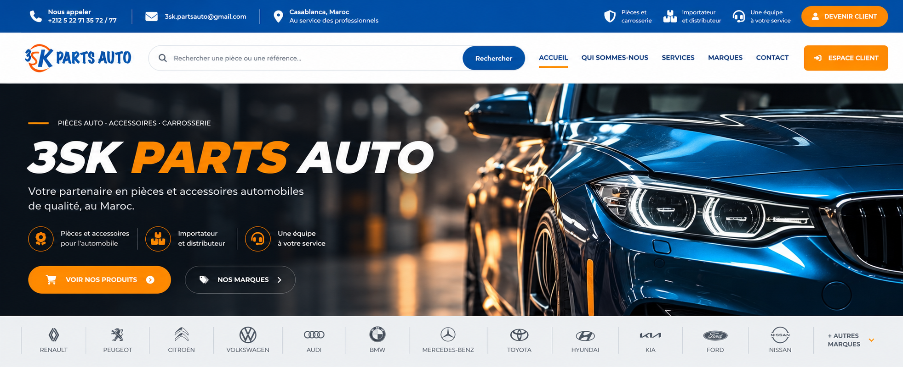
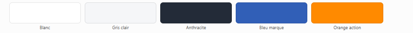

# Contrat de design - 3SK Parts Auto

**Statut : actif. Version 2.3. Header commun et premier slide identique entre accueil public et connecté.**

Ce contrat est la référence visuelle pour les prochaines interventions sur le projet.
Il concerne l'accueil public, la connexion, l'espace client, l'administration et leurs
composants partagés. Une nouvelle instruction explicite de l'utilisateur peut le faire
évoluer ; une préférence du développeur ne suffit pas.

## Maquette visuelle validée



Cette capture, fournie avec le message « voici la version validé », constitue la
référence de composition pour la partie supérieure de l'accueil public :

- Topbar bleue : coordonnées réelles, informations de service et unique action
  « Espace client » orange, menant à la connexion.
- Header blanc : logo à gauche, recherche et navigation utile, sans second bouton
  orange à côté de Contact. Le header reste sticky conformément à la demande précédente.
- Slider pleine largeur : visuel automobile, titre blanc/orange **sans italique**,
  texte lisible à gauche, trois avantages et deux actions fonctionnelles.
- Bande des constructeurs sur **fond gris clair**, avec vrais logos en
  anthracite/gris, noms lisibles et séparateurs fins. Pas de fond bleu pour cette bande.
- Action « Autres marques » uniquement si des marques supplémentaires existent,
  avec ouverture d'un contenu réel.

La palette HEX de la section 1 reste la source exacte des couleurs de l'interface ;
les nuances photographiques, ombres ou différences de rendu de la capture ne
définissent pas de nouvelles couleurs de marque.

Cette validation n'autorise pas à remplacer les médias du slider de sa propre
initiative ni à modifier les règles métier. Elle ne valide pas de changement sur
les sections ou pages absentes de la capture. La version mobile doit adapter cette
composition sans texte coupé ni navigation inutilisable.

L'archivage de cette référence ne signifie pas que toutes ses différences ont déjà
été intégrées ou déployées. Toute intervention reste limitée à la demande en cours.

## 1. Palette officielle



Les valeurs suivantes sont relevées au centre des aplats de la capture fournie.
Elles font référence, même si certains anciens styles utilisent des nuances proches.

| Couleur | HEX exact | RGB | Usage |
| --- | --- | --- | --- |
| Blanc | `#FFFFFF` | `255, 255, 255` | Fond principal, header, formulaires et surfaces claires. |
| Gris clair | `#F5F6F8` | `245, 246, 248` | Fonds secondaires, zones de regroupement et en-têtes de tableaux. |
| Anthracite | `#232B38` | `35, 43, 56` | Texte principal, titres, pictogrammes et détails contrastés. |
| Bleu marque | `#315FB7` | `49, 95, 183` | Navigation, liens, sélection et identité de marque. |
| Orange action | `#FF8A00` | `255, 138, 0` | Actions principales et accents visuels ciblés. |

### Règles de couleur

- Ne pas remplacer ces valeurs par des couleurs approchantes.
- Ne pas ajouter de nouvelle couleur décorative sans validation explicite.
- Privilégier les fonds blancs et gris clair ; ne pas introduire de grands blocs noirs
  ou bleu nuit sans demande explicite.
- Réserver l'orange aux actions et accents : ne pas en faire un fond dominant partout.
- Utiliser des variantes de survol, bordures et ombres dérivées de cette palette
  (opacité ou mélange avec le blanc/anthracite), plutôt que de nouveaux HEX arbitraires.
- Vérifier le contraste des textes, notamment sur les boutons orange ; employer
  l'anthracite lorsque le blanc ne reste pas suffisamment lisible.
- Conserver les couleurs fonctionnelles existantes des états métier : rouge pour
  indisponibilité/erreur, vert pour disponibilité/succès. Elles ne servent pas de
  couleurs décoratives et ne doivent pas modifier le sens des états existants.

### Tokens de référence

Lorsqu'une modification nécessite des couleurs, réutiliser les variables centrales
existantes et les aligner sur ces valeurs dans le périmètre autorisé :

```css
--brand-surface: #FFFFFF;
--brand-bg: #F5F6F8;
--brand-anthracite: #232B38;
--brand-ink: var(--brand-anthracite);
--brand-blue: #315FB7;
--brand-orange: #FF8A00;
```

Si des variables Bootstrap, SCSS ou locales sont concernées, leurs valeurs HEX et RGB
doivent rester cohérentes avec ces tokens. Éviter les couleurs recopiées dans chaque
composant et les surcharges locales contradictoires.

## 2. Éléments à préserver

- **Images du slider :** conserver les médias configurés dans l'administration.
  Ne pas remplacer une image validée, ajouter un nouveau visuel devant elle, ni créer
  une variante générée sans demande explicite. Une demande de design ne vaut pas
  autorisation de changer les images.
- **Identité et informations :** conserver le logo, les coordonnées, les textes
  validés et les destinations existantes, sauf demande explicite portant dessus.
- **Header public :** rester sticky au défilement sur ordinateur et mobile. Les
  sections ciblées par le menu doivent rester visibles sous le header.
- **Navigation :** chaque lien ou bouton doit mener à une destination ou action réelle.
  Ne pas ajouter de menu vide, de lien factice ou d'action redondante sans utilité.
- **Marques :** utiliser les vrais logos et les marques réellement présentes dans
  le catalogue ; ne pas inventer de marques ni utiliser un libellé technique comme marque.
- **Composants partagés :** conserver un footer commun et des composants cohérents
  entre l'accueil, la connexion et l'espace connecté.

## 3. Typographie et mise en page

- Garder une hiérarchie claire et éviter le gras généralisé.
- Texte courant en poids normal ; labels, menus et boutons visuellement mesurés.
- Réserver les graisses fortes aux vrais titres et mises en avant utiles.
- Réutiliser les familles de caractères du projet, sans nouvelle police non validée.
- Conserver les alignements, espacements et largeurs validés dans la zone concernée.
- Éviter les fonds, cadres, ombres et blocs supplémentaires non demandés.
- Garantir la lisibilité sur téléphone, tablette et ordinateur : aucun texte coupé,
  chevauchement incohérent ou défilement horizontal involontaire.

## 4. Limite de l'intervention visuelle

Une modification graphique ne doit pas changer la logique de recherche, les règles
de stock, les prix, les remises, les commandes, les paniers, les imports, les droits
d'accès ou le fonctionnement des formulaires.

Les quantités de stock restent réservées à l'administrateur conformément aux règles
existantes ; un client normal voit le statut de disponibilité. Ne pas exposer de
données supplémentaires sous prétexte de changer leur présentation.

Ne pas supprimer une fonctionnalité existante pour simplifier une maquette.
Ne pas retoucher des zones sans rapport avec la demande et ne pas annuler des
modifications préexistantes de l'utilisateur.

## 5. Vérification avant livraison

1. Relire ce contrat et identifier le périmètre exact de la demande.
2. Vérifier la palette, les images et les informations conservées.
3. Tester les liens, boutons, menus, modales et formulaires concernés.
4. Vérifier le sticky, les ancres et le rendu responsive si ces composants sont touchés.
5. Contrôler les fichiers PHP/Twig/JavaScript concernés et inspecter des captures
   desktop/mobile pour une modification visible.
6. Signaler les vérifications impossibles et distinguer modification locale et déploiement.

## 6. Application à partir de maintenant

La création de ce contrat ne repeint pas automatiquement le site. Les différences
historiques sont corrigées lors d'une intervention autorisée dans la zone concernée,
ou lors d'une harmonisation globale explicitement demandée.

En particulier, les anciens bleu `#315FBB` et orange `#FF9100` ne doivent pas être
considérés comme la nouvelle référence : la palette officielle est celle de la section 1.

## 7. Direction boutique professionnelle

La référence complémentaire fournie par l'utilisateur le 16 octobre 2026 est
archivée dans `docs/design/boutique-inspiration-2026-10-16.png`. Elle sert de repère
de qualité, de hiérarchie et de composition e-commerce, **pas de modèle à copier**.
Elle ne remplace ni la palette officielle, ni les photos et informations du site.

- Header compact et lisible, recherche bien intégrée, navigation fonctionnelle.
- Titres proportionnés au contenu ; éviter les titres d'affiche dans les sections
  de catalogue et les blocs secondaires.
- Sections alignées, espacements réguliers, fonds sobres et accents orange ciblés.
- Cartes produits blanches avec images bien cadrées, informations hiérarchisées,
  prix lisibles et commandes de quantité régulières.
- Sur téléphone, filtres repliables sans suppression de champs ni modification des
  sélections ; les produits doivent rester faciles à atteindre.
- Footer partagé sobre, coordonnées conservées et absence de surcharge décorative.
- Ne pas inventer d'avis, notes, promotions, compte à rebours, produits, marques,
  rubriques ou liens pour ressembler à la référence.

L'évolution autorise un raffinement de la composition existante. Les obligations
de conservation des médias, du sticky et des règles métier restent inchangées.

## 8. Bloc marques partenaires

La référence `docs/design/marques-partenaires-reference-2026-10-16.png`, fournie
ensuite par l'utilisateur, définit le rendu demandé pour ce bloc partagé entre
l'accueil public et connecté :

- Fond très clair avec de larges courbes bleu pâle, et panneau blanc translucide
  arrondi. Ne pas remplacer ce fond par un simple aplat blanc ou bleu.
- Mention « Nos marques phares » bleue précédée d'un court trait orange.
- Titre anthracite avec « partenaires » bleu, description alignée à droite sur desktop.
- Les 24 vrais logos existants en couleur, dans le même ordre, en six colonnes sur
  grand écran, avec des tuiles blanches arrondies, espacées et légèrement ombrées.
- Grille adaptée en trois puis deux colonnes sur tablette et téléphone, sans débordement.

Cette précision ne change ni la bande des constructeurs située sous le slide, ni
les images du slide, ni les informations ou les règles métier.

## 9. Footer et typographie commune

La référence `docs/design/footer-reference-2026-10-16.png` définit le bas de page :
chiffres réels regroupés sur une surface blanche, fond automobile discret, identité
et coordonnées à gauche, paiement et aide, navigation, carte de localisation, puis
bande anthracite séparée par une courbe orange. Réutiliser les médias existants ;
les chiffres ne doivent jamais être copiés en dur depuis la capture.

Le footer reste partagé entre accueil, connexion, espace client et administration.
Les quatre numéros restent accessibles dans la modale existante. Facebook et
Instagram restent temporairement sur `#`, conformément à la réponse explicite de
l'utilisateur ; WhatsApp utilise le lien réel existant.

L'échelle commune est définie dans `public/styles/typography.css` :

| Usage | Ordinateur | Mobile |
| --- | --- | --- |
| Titre de page / connexion | 28 px | 24 px |
| Titre de section applicative | 24 px | 22 px |
| Titre de section publique | 36 px | 28 px |
| Titre de panneau | 18 px | 18 px |
| Titre de modale | 20 px | 20 px |
| Texte courant | 16 px | 16 px |
| Champs de saisie | 16 px | 16 px |
| Bouton standard / compact | 14 px / 13 px | 14 px / 13 px |
| Label / texte secondaire | 13 px | 13 px |
| En-tête de tableau / badge / métadonnée compacte | 12 px | 12 px |

Roboto reste la police de lecture ; Montserrat reste utilisée pour les titres et
contrôles existants. Les boutons importants peuvent conserver 16 px. Les titres
du slide et du bloc partenaires conservent leur hiérarchie spécifique validée :
ne pas les réduire à celle d'un titre de panneau. Utiliser des tailles fixes par
palier responsive, pas de taille de police proportionnelle à la largeur du viewport.

Les bons imprimables gardent leur échelle physique compacte adaptée au papier ;
les templates email ne sont pas soumis aux CSS du site. Ne pas augmenter leurs
espacements ni réintroduire de prix dans le bon de commande pendant un audit visuel.

## 10. Présentation et services de l'accueil public

Les références `docs/design/presentation-reference-2026-10-16.png` et
`docs/design/services-reference-2026-10-16.png` définissent ces deux blocs uniquement.

- Présentation : photo d'entrepôt à gauche, cadre blanc arrondi, angle bleu,
  tracé orange et pictogramme colis. Fond clair à bandes diagonales et motifs
  discrets. À droite, titre « 3SK Parts Auto », textes existants et trois éléments
  2014, B2B et 1M avec leurs pictogrammes. Conserver ces informations.
- Services : grand titre sur deux lignes à gauche, quatre services en grille
  avec icônes orange et descriptions de la capture. À droite, carrousel arrondi,
  flèches blanches, cinq indicateurs, texte de stock et lien réel vers la connexion.
- Réutiliser la photo d'entrepôt et les cinq visuels existants du carrousel.
  Le visuel POLIPLAST est présenté initialement ; les autres restent accessibles.
  Ne pas remplacer ces médias ou le slide principal par une image générée.
- Ces deux titres suivent la hiérarchie spécifique des nouvelles captures :
  harmonisée à 48 px pour la présentation et Services, puis 32 px sur téléphone
  après la nouvelle demande d'audit typographique. Le texte de présentation est
  de 18 px sur grand écran et 16 px sur mobile.
  Cela ne modifie pas l'échelle des autres pages, du catalogue ou des formulaires.
- Employer le bleu et l'anthracite exacts de la palette, même si les captures
  présentent des nuances plus vives ou plus sombres.
- Sur téléphone, empiler les contenus, conserver tous les textes et cadrer les
  images du carrousel sans couper les pièces. Le carrousel et les effets de
  défilement existants restent fonctionnels.

Les styles de ces deux blocs sont isolés dans `public/styles/home-about-services.css`.
Cette demande ne concerne ni le header, ni le slide principal, ni le bloc partenaires,
ni le footer, ni les règles métier.

## 11. Protection des sections validées après rollback

Le dernier brief « Rollback et harmonisation » remplace la demande d'harmonisation
globale précédente. Les anciens blocs validés sont la référence : les zones encore
inabouties doivent s'adapter à eux, et jamais l'inverse.

- Ne pas modifier l'apparence desktop du header, du hero, de la bande véhicules,
  de la présentation d'activité, du bloc DEPO avec ses formes, des trois cartes
  2014/B2B/1M, des Services, des logos partenaires, des statistiques ou du footer.
- Conserver les fonds subtils, les détails bleus/orange, les arrondis, les ombres,
  les deux familles typographiques existantes et les images réelles.
- La palette de la section 1 reste inchangée. Les nouveaux neutres et la police
  unique introduits pendant l'intervention annulée ne s'appliquent pas.
- Le contact peut évoluer dans ses propres fichiers, avec des sélecteurs strictement
  limités à `#contact.contact-premium`. Aucun changement du thème global pour ce bloc.
- Conserver l'action du formulaire, tous les noms/champs/contraintes, le CSRF,
  le honeypot et le script d'envoi existants, ainsi que leurs messages de résultat.
- Après la retouche du contact, comparer les styles et captures des neuf sections
  protégées avec l'état du rollback sur ordinateur, tablette et mobile.

Les sauvegardes de cette intervention sont conservées dans
`tmp/rollback-design-20261016-1918/` : état avant rollback et versions restaurées.
Ne pas les utiliser comme une restauration globale automatique du projet.

## 12. Alignement du contenu de l'accueil public

La demande explicite du 16 octobre 2026 autorise uniquement l'harmonisation des
marges horizontales des blocs sous le hero : introduction, présentation, services,
partenaires, espace client/contact, statistiques et footer. Ils partagent désormais
un même repère à gauche et à droite, défini dans `public/styles/home-layout.css`.

- Garder une marge symétrique de 4,35 % sur grand écran, puis 40 px jusqu'à
  1439 px, 24 px jusqu'à 991 px et 18 px jusqu'à 575 px.
- Préserver les espacements intérieurs des cartes et panneaux, les compositions,
  les couleurs, les textes, les médias, les fonds et les espacements verticaux.
- Le motif diagonal des Services a été retiré à la demande de l'utilisateur ;
  conserver la voiture en transparence et les décors des autres sections.
- Cette harmonisation est propre à l'accueil public. Ne pas changer les marges
  des autres pages, le header, le hero ou la grille des constructeurs.

## 13. Page de connexion

La refonte demandée le 16 octobre 2026 reprend les codes de l'accueil : fond gris
clair à motifs discrets, photographie réelle du stock, détails bleus et orange,
formulaire blanc et bouton de connexion orange avec texte anthracite lisible.
Les styles restent limités à `.login-experience` dans `public/styles/login.css`.

- Conserver le header sticky et le footer partagés sans surcharge locale.
- Sur téléphone et tablette, centrer le formulaire et masquer la présentation
  photographique secondaire pour garder un accès direct à la connexion.
- Garder le POST de connexion, les champs `email`, `password`, `_csrf_token`,
  le CSRF `authenticate`, les valeurs et erreurs Symfony, les contraintes,
  l'autocomplétion, l'autofocus et les règles d'authentification existantes.
- L'affichage du mot de passe doit conserver la saisie et annoncer son état.
  L'aide ouvre la modale téléphonique existante ; le retour mène à l'accueil.
- Le fond vidéo décoratif historique n'est plus utilisé sur cette page.

## 14. Espace connecté et filtres du catalogue

La nouvelle demande du 16 octobre 2026 étend l'harmonisation visuelle aux pages
client et administrateur. L'accueil public et la connexion déjà réalisés restent
les références ; cette extension n'autorise pas à les refaire.

- Ne créer aucune information, statistique, marque, offre, rubrique ou donnée
  commerciale. Conserver tous les libellés, valeurs, champs et destinations réels.
- Employer la topbar bleue, les fonds blancs/gris clair, les titres anthracite,
  les détails orange et les polices existantes. Les pages de gestion restent
  compactes et fonctionnelles, sans composition de landing page.
- Conserver une échelle de titres de 28 px sur ordinateur et 24 px sur téléphone,
  des labels lisibles et des actions principales orange à texte anthracite.
  Garder les états fonctionnels rouges/verts et les styles désactivés existants.
- Les styles applicatifs sont isolés dans `public/styles/connected-ui.css`,
  chargé uniquement après connexion. Les panneaux, champs, tableaux, boutons
  et menus reprennent des bordures et espacements cohérents.
- Le catalogue utilise un bandeau de filtres au-dessus de la grille complète :
  mot-clé, famille, marque, véhicule, année et disponibilité. Sur grand écran,
  les quatre premiers critères partagent une ligne ; les critères secondaires
  et actions se placent dessous. Le bloc reste repliable sur mobile.
- La présentation des filtres est isolée dans `public/styles/catalog-filters.css`.
  Conserver les identifiants des contrôles, les sélections, les paramètres URL,
  les résultats API, la pagination et le chargement au défilement.
- Ne modifier ni la recherche, ni les prix/remises, stocks, paniers, commandes,
  imports, droits, CSRF ou formulaires. Les quantités de stock restent réservées
  aux administrateurs, sur les cartes comme sur la fiche article.
- Sur mobile, le tableau clients défile horizontalement sans écraser les noms.
  Le bouton WhatsApp démarre en bas de l'écran ; sa position personnalisée et
  son déplacement restent disponibles. Ne pas le laisser masquer les filtres
  par sa position initiale au milieu de l'écran. Il s'efface temporairement
  lorsque les filtres sont ouverts sur mobile et réapparaît à leur fermeture.
- Les bons imprimables, exports, emails et médias validés restent inchangés.

## 15. Raffinement du catalogue et header commun

La demande suivante du 16 octobre 2026 précise le fonctionnement et la présentation :

- Retirer le bandeau « Articles / Recherche instantanée + filtres ».
- Placer une barre blanche compacte directement sous le menu, sans carte flottante.
  Les six critères partagent une ligne sur grand écran ; les filtres restent
  repliables et lisibles sur mobile. Sur grand écran, la barre suit le header sticky.
- Appliquer famille, marque, véhicule, disponibilité et année automatiquement.
  Déclencher la recherche textuelle après une courte pause de saisie, sans enlever
  les espaces saisis dans le champ actif. Retirer Appliquer et Effacer ; garder un
  unique reset dans la barre, annulant aussi la saisie en attente et le mode arrivages.
- Une ancienne requête ne doit pas remplacer les derniers critères. Conserver les
  paramètres URL, la pagination, les résultats API et le chargement au défilement.
- La navigation connectée est plate : pas de pastille, de fond au survol ou de
  soulignement arrondi. Employer un trait fin et droit pour le lien actif.
- Les cartes du catalogue et des arrivages partagent les vrais logos de
  `public/img/brand-logos/`. Noms de fichiers minuscules, sans accent, mots séparés
  par un tiret : `nom-de-la-marque.png` (ou webp/jpg/jpeg/svg). Détection automatique,
  sans ajout de correspondance en code. Conserver le nom si l'image manque.
- Utiliser le même header de marque hors connexion et après connexion : coordonnées
  partagées, topbar bleue, bouton Espace client orange, logo, recherche blanche avec
  action bleue et mêmes repères. Après connexion, conserver compte, notifications,
  paramètres administrateur, recherche vocale, panier, arrivages et catégories réels.
- Les coordonnées proviennent d'un partial commun. Les trois avantages du top
  header restent uniquement sur la version publique, regroupés près du bouton
  Espace client avec l'espacement normal de la barre, sans marge automatique entre
  les deux. Ne pas rendre ce bloc après connexion, y compris sur le profil.
  Le header connecté reprend le style public ; ses catégories restent sa navigation métier.
  Ne pas y ajouter des ancres vers des sections inexistantes de l'accueil connecté.
- Les styles communs sont dans `public/styles/header-common.css`. Adapter les
  informations secondaires à la largeur disponible sans perdre les accès au compte.
- Harmoniser les textes avec l'échelle de la section 9 ; garder les grands titres
  de présentation à 48/32 px et les titres du hero validés. Les contrôles de quantité
  et panier ne doivent pas déborder des cartes, même à 320 px.

Cette évolution n'autorise aucune modification des prix, stocks, paniers, imports,
commandes, authentification ou droits. Aucun champ métier, image, statistique ou
marque n'est inventé. L'impression conserve son échelle compacte et reste sans prix.

## 16. Slide de l'accueil connecté

La capture complémentaire du 16 octobre 2026 précise que le premier slide connecté
doit reprendre le bloc public complet, pas seulement ses styles : mention Pièces auto,
titre « 3SK PARTS AUTO », présentation, trois avantages avec leurs icônes et actions
« Voir nos produits » / « Nos marques ». Le contenu provient du même partial Twig
`home/sections/_showcase_intro.html.twig` ; les styles restent partagés dans
`public/styles/public-showcase.css`.

- Ne pas modifier le rendu de l'accueil public pour l'adapter au connecté.
- Conserver les images, vidéos et ordre configurés dans l'administration. Le premier
  slide affiche la composition de marque validée sans réécrire les données en base ;
  les suivants conservent leurs titres, sous-titres et liens configurés.
- Les deux actions mènent au catalogue réel et au bloc partenaires de la même page.
  Garder ce dernier visible sous le header sticky après navigation par l'ancre.
- Garder le chargement différé, le défilement existant et les commandes administrateur
  avec leurs routes, méthodes, CSRF et droits d'accès.
- Partager les paliers responsive et vérifier les débordements. Les commandes admin
  peuvent disposer d'un espace supplémentaire sur mobile sans couvrir le contenu.
